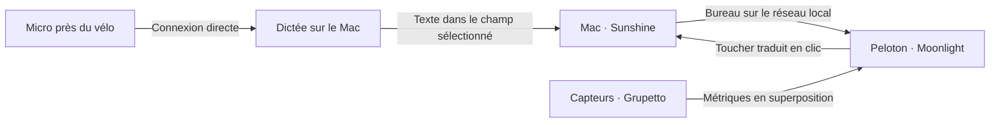

# Peloton Desk

Travailler sur un Mac depuis l’écran tactile d’un Peloton Bike, avec la vitesse,
la résistance et la durée visibles en superposition. La dictée utilise le logiciel
déjà installé sur le Mac. VoiceInk est le choix initial, car il a été détecté localement.

Ce dépôt contient les outils de diagnostic, les lanceurs et le guide d’installation.
L’image et le tactile passent par Sunshine/Moonlight ; les métriques viennent de Grupetto.
Le fonctionnement complet sur le Bike reste à valider.



## Démarrer

Python 3.10+ suffit pour ces outils, sans dépendances Python à installer.

```sh
make doctor
make plan
```

`doctor` vérifie les applications du Mac, ADB, l’appareil connecté et les paquets
Android nécessaires. Il ne modifie pas les réglages. Un code de sortie `1` signifie
que des prérequis manquent ; `2` signale une erreur d’utilisation ou d’exécution.
Ces codes sont ceux de l’outil Python ; Make remonte ses propres codes d’échec.
Même un résultat entièrement positif ne valide pas encore l’expérience tactile/vocale.

`plan` affiche les commandes de lancement du Mac sans les exécuter.
Après installation et configuration, `make host` ouvre Sunshine et VoiceInk en
arrière-plan, sans déclencher d’enregistrement ni lancer la connexion au Bike.

Pour choisir un autre logiciel de dictée :

```sh
make doctor VOICE_APP=superwhisper
make host VOICE_APP=superwhisper
```

Le nom doit correspondre au bundle `.app` présent dans `/Applications` ou
`~/Applications`. Le lanceur Sunshine attend lui aussi le bundle macOS installé
depuis le DMG ; une installation CLI seule doit être lancée séparément.

Le Bike peut se connecter en Wi-Fi par code d’appairage ou en USB ; voir le
[guide de connexion](docs/setup.md#1-identifier-lécran-et-préparer-la-liaison).
Après connexion, relever son identifiant avec `adb devices -l`, puis :

```sh
python3 tools/desk.py doctor --serial IDENTIFIANT_DU_BIKE
python3 tools/desk.py launch-bike metrics --serial IDENTIFIANT_DU_BIKE
python3 tools/desk.py launch-bike moonlight --serial IDENTIFIANT_DU_BIKE
```

Ces deux dernières commandes ouvrent les applications déjà installées. La première
configuration de l’overlay et la sélection du bureau Mac restent dans leurs interfaces.
Ajouter `--dry-run` pour afficher une commande sans contacter le Bike.

## Installation et validation

Suivre [le guide de configuration](docs/setup.md), puis
[le scénario de validation](docs/validation.md).

État à la création du dépôt :

- Mac Apple Silicon, macOS 26.7.1.
- VoiceInk et ADB détectés.
- Sunshine non détecté dans les dossiers d’applications standards ni dans le PATH.
- Aucun appareil ADB connecté : modèle d’écran et version Android encore inconnus.
- Aucun test de streaming, de dictée à distance ou d’overlay effectué sur le Bike.

Les rapports personnels peuvent être conservés dans `.local/`, exclu de Git :

```sh
mkdir -p .local
python3 tools/desk.py doctor --json > .local/doctor.json
```

## Développement

```sh
make test
```

Les tests couvrent le ciblage ADB, les appareils non autorisés, les délais d’attente,
le mode simulation et les erreurs Android renvoyées avec un code de sortie zéro.

Le développement éventuel d’un bouton tactile de dictée ou d’une barre de métriques
personnalisée vient après le premier essai sur le matériel. Le bouton devra conserver
le focus du champ sur le Mac et utiliser le déclencheur du logiciel de dictée choisi.
Une API de déclenchement VoiceInk n’est pas encore validée.

## Références

Sources consultées le 16 octobre 2026 :

- [OpenPelo et son installation](https://github.com/doudar/Openpelo).
- [Catalogue OpenPelo : Moonlight et Grupetto](https://github.com/doudar/Openpelo/blob/main/apps_config.json).
- [Sunshine sur macOS](https://docs.lizardbyte.dev/projects/sunshine/latest/md_docs_2getting__started.html).
- [Moonlight : bureau et commandes tactiles](https://github.com/moonlight-stream/moonlight-docs/wiki/Setup-Guide).
- [Grupetto : métriques, overlay et chronomètre](https://github.com/doudar/grupetto).
- [VoiceInk : raccourcis de dictée configurables](https://github.com/Beingpax/VoiceInk).

Les logiciels tiers gardent leurs licences et leurs propres procédures d’installation.
